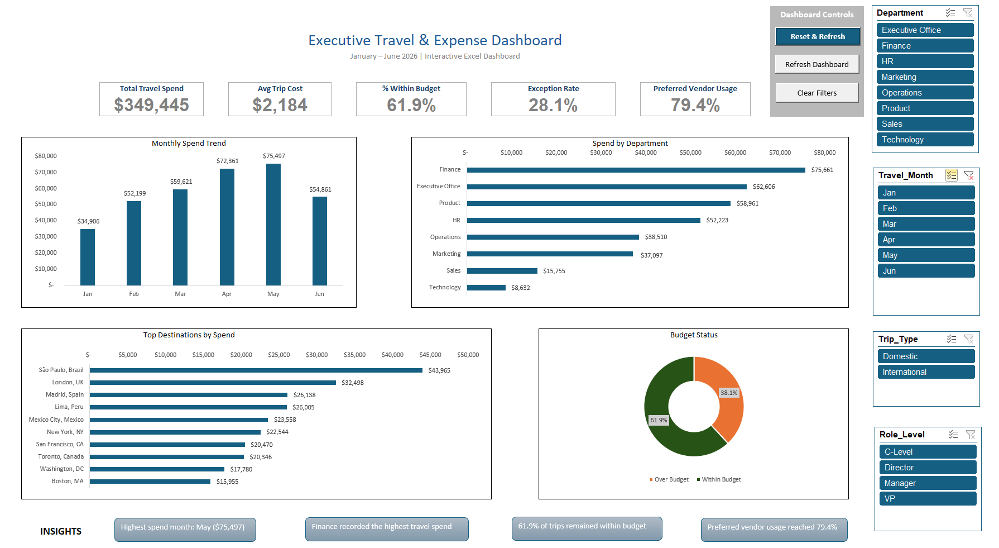

# Hi, I'm Giovanna Fuentes 👋

### Operations & Executive Support | Business Analytics | Automation

I am an operations professional with extensive experience supporting executives and managing travel, vendors, facilities, and business operations.

I combine operational experience with Excel, VBA, SQL, and data analysis to improve processes, monitor performance, control costs, and support better business decisions.

---

## About Me

- 20+ years of experience in administrative operations, executive support, travel, facilities, and vendor management
- Experienced supporting senior leaders and cross-functional teams
- Strong background in corporate travel management and operational coordination
- Currently expanding my skills in business analytics, SQL, dashboards, and automation
- Based in Florida, USA
- Bilingual: Spanish and English | Intermediate Portuguese

---

## Technical Skills

---

## Core Professional Skills

- Executive Support
- Travel & Expense Management
- Vendor Management
- Facilities & Operations
- Process Improvement
- Business Analysis
- Executive Reporting
- Stakeholder Coordination
- Cost Control
- Policy Compliance

---

## Soft Skills

- Organization and prioritization
- Problem solving
- Adaptability
- Clear communication
- Attention to detail
- Cross-functional collaboration
- Service orientation
- Continuous learning

---

## Connect With Me

---

# Featured Project

## Executive Travel & Expense Dashboard

Interactive Excel dashboard designed to monitor corporate travel spend, budget compliance, preferred vendor usage, and policy exceptions.

### Dashboard Preview

### Business Results

- 160 corporate travel records analyzed
- $349,445 total travel spend
- $2,184 average trip cost
- 61.9% of trips within budget
- 28.1% policy exception rate
- 79.4% preferred vendor usage
- 45 policy exception trips identified

### Dashboard Features

- 5 executive KPI cards
- Monthly Spend Trend
- Spend by Department
- Top Destinations by Spend
- Budget Status
- Interactive slicers for Department, Travel Month, Trip Type, and Role Level

### Automation

- Refresh Dashboard
- Clear Filters
- Reset & Refresh
- Highlight Policy Exceptions
- Automated exception counting

### Tools Used

### Tools Used

---

## Current Focus

- Business Analytics
- SQL
- Excel Automation
- Executive Operations Reporting
- Data-driven Process Improvement
